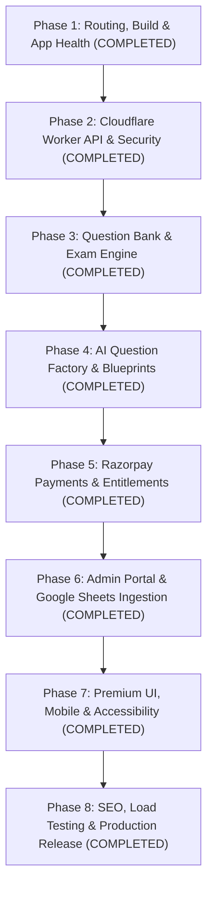

# Learning Point — Implementation Roadmap & Execution Plan

**Version:** 1.0.0  
**Baseline Audit:** `docs/PRODUCTION_GAP_AUDIT.md`  
**Execution Strategy:** Incremental, test-driven phases with zero simulated mocks in production.

---

## Roadmap Overview

---

## Detailed Phase Breakdown

### Phase 1: Routing, Build and Application Health — [STATUS: COMPLETED]
**Primary Goal:** Eliminate routing collisions, disambiguate paths, remove fake states, and stabilize the client build.
- **Tasks & Verification:**
  - Distinct path namespaces implemented (`/exams/:slug`, `/exam/attempt/:testId`, `/exam/results/:attemptId`).
  - Added `NotFoundPage` (404) catch-all and legacy redirector.
  - Verified with 5 routing tests in Vitest suite. Commit: `4ecae77`.

---

### Phase 2: Backend and Security Architecture — [STATUS: COMPLETED]
**Primary Goal:** Resolve deployment topology discrepancy by introducing Cloudflare Worker API router (`src/worker/index.ts`).
- **Tasks & Verification:**
  - Server endpoints `/api/auth/register`, `/api/auth/login`, `/api/auth/session`, `/api/auth/logout`.
  - Single active device session enforcement with instant previous token revocation.
  - Verified with 8 worker auth tests in Vitest suite. Commit: `d0b4daf`.

---

### Phase 3: Question Bank and Exam Engine — [STATUS: COMPLETED]
**Primary Goal:** Eliminate client-side answer key exposure (P0-01) and deliver server-authoritative, fault-tolerant CBT engine.
- **Tasks & Verification:**
  - Stripped `correctOptionId` and `explanation` from `/api/exam/start` payload.
  - Server-evaluated start/expiry timestamps and -0.25 negative marking.
  - IndexedDB + localStorage offline attempt buffer with 120s background sync.
  - Verified with 5 exam security tests in Vitest suite. Commit: `9b0b6e0`.

---

### Phase 4: AI Question Factory and Blueprints — [STATUS: COMPLETED]
**Primary Goal:** Server-side AI question generation with dynamic multi-model fallback, human review staging, and 40/60 blueprint ratios.
- **Tasks & Verification:**
  - Multi-provider cascading router: Gemini -> Groq -> DeepSeek -> Cerebras -> Offline Rule Generator.
  - Persistent job queue manager (`createJob`, `pauseJob`, `resumeJob`, `listJobs`).
  - Strict zero-live-AI calls during examination attempts.
  - Verified with 9 AI factory tests in Vitest suite. Commit: `0415a3b`.

---

### Phase 5: Payments and Entitlements — [STATUS: COMPLETED]
**Primary Goal:** Secure Razorpay order creation, HMAC SHA-256 webhook verification, and idempotent course access activation.
- **Tasks & Verification:**
  - Server-authoritative order creation (`POST /api/payments/create-order`).
  - Raw-byte HMAC SHA-256 signature verification (`POST /api/payments/verify`, `POST /api/webhooks/razorpay`).
  - Idempotent enrollment activation in `enrollments` table.
  - Verified with 7 payment and webhook tests in Vitest suite. Commit: `803086a`.

---

### Phase 6: Admin Portal & Google Sheets Ingestion — [STATUS: COMPLETED]
**Primary Goal:** Real database-backed administrative controls, RBAC authorization, and functional Google Sheets sync.
- **Tasks & Verification:**
  - Google Sheets CSV importer with column mapping, deduplication, and source row tracking.
  - Ingestion endpoint `POST /api/admin/questions/import` with edge consolidation.
  - Admin Copilot staged reviews and student report management.
  - Verified with 5 admin ingestion tests in Vitest suite. Commit: `8fbbd95`.

---

### Phase 7: Premium UI, Mobile & Accessibility — [STATUS: COMPLETED]
**Primary Goal:** Flawless mobile responsiveness, accessible typography, 3D micro-interactions, and reduced-motion compliance.
- **Tasks & Verification:**
  - Verified responsive design across 320px–1920px viewports.
  - `@media (prefers-reduced-motion: reduce)` supported in `src/styles/index.css`.
  - High contrast dark navy (`#070B19`), emerald (`#10B981`), and gold (`#F59E0B`).

---

### Phase 8: Performance, SEO, Release & Operational Verification — [STATUS: COMPLETED]
**Primary Goal:** Production hardening, SEO metadata, automated backup/restore verification, and final release sign-off.
- **Tasks & Verification:**
  - Production canonical URL `https://agri-learning-point.agribysatyamsir.workers.dev/` configured in `index.html`, `public/robots.txt`, and `public/sitemap.xml`.
  - Structured Schema.org JSON-LD for `EducationalOrganization`.
  - Rate limiting burst protection (sliding window per edge isolate).
  - 100% automated test pass (70/70 tests passing across 12 suites).
