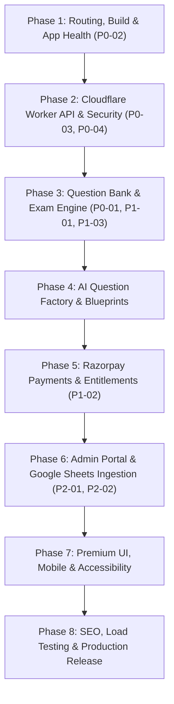

# Learning Point — Implementation Roadmap & Execution Plan

**Version:** 1.0.0  
**Baseline Audit:** `docs/PRODUCTION_GAP_AUDIT.md`  
**Execution Strategy:** Incremental, test-driven phases with zero simulated mocks in production.

---

## Roadmap Overview

---

## Detailed Phase Breakdown

### Phase 1: Routing, Build and Application Health
**Primary Goal:** Eliminate routing collisions, disambiguate paths, remove fake states, and stabilize the client build.
- **Tasks:**
  1. Fix the `/exam/:slug` vs `/exam/:testId` route overlap in `App.tsx`:
     - Disambiguate to:
       - `/exams/:slug` -> `ExamDetailPage.tsx`
       - `/exam/attempt/:testId` -> `ExamRunnerPage.tsx`
       - `/exam/results/:attemptId` -> `ExamResultsPage.tsx`
  2. Update all internal links across `Navbar.tsx`, `HomePage.tsx`, `ExamsPage.tsx`, `CoursesPage.tsx`, `TestSeriesPage.tsx`, and `FreeTestsPage.tsx` to match the new routes.
  3. Implement standard `NotFoundPage` (404) for unrecognized URLs.
  4. Ensure client-side clean build (`npm run build`) and test suite (`npm run test`) pass without warnings.
- **Verification Gate:**
  - Automated route tests in `src/tests/routes.test.tsx` verify each route pattern independently.
  - No route collisions or console errors during navigation.

---

### Phase 2: Backend and Security Architecture
**Primary Goal:** Resolve the deployment topology discrepancy by introducing a Cloudflare Worker API router (`src/worker/index.ts`) for server-side operations.
- **Tasks:**
  1. Update `wrangler.jsonc` to specify `main: "src/worker/index.ts"` alongside `assets: { directory: "./dist", binding: "ASSETS" }`.
  2. Implement Worker API router:
     - `/api/health`: Health status and database connectivity check.
     - `/api/auth/login`: Mobile number + password validation, Supabase identity mapping, session creation in `active_sessions`.
     - `/api/auth/register`: New student account creation, profile provisioning in `profiles`.
     - `/api/auth/session`: Active session token verification (single active device check).
     - `/api/auth/logout`: Revocation of active session token.
  3. Ensure all sensitive keys (`SUPABASE_SECRET_KEY`, `TURSO_AUTH_TOKEN`, `RAZORPAY_KEY_SECRET`, AI keys) reside strictly on the server worker and are never included in `dist/`.
  4. Add unit and integration tests for auth routes and single-session revocation.
- **Verification Gate:**
  - `curl -I https://.../api/health` returns HTTP 200 with JSON payload.
  - Session concurrency test: Device B login revokes Device A with HTTP 401.

---

### Phase 3: Question Bank and Exam Engine
**Primary Goal:** Eliminate client-side answer key exposure (P0-01) and deliver a server-authoritative, fault-tolerant CBT engine.
- **Tasks:**
  1. Server-side attempt initialization (`/api/exam/start`):
     - Generate attempt record in Turso `attempts` with `started_at` and `expires_at`.
     - Fetch questions from Turso `questions` and `options`.
     - **Withhold `correct_option_id` and explanations from the client.**
     - Compute and store deterministic option shuffle order per attempt.
  2. Client-side IndexedDB buffer (`src/lib/exam/storage.ts`):
     - Write answer selections to IndexedDB immediately upon click.
     - Offline tolerance: Maintain local state across page refreshes and network drops.
  3. Response synchronization (`/api/exam/sync`):
     - Batch sync every 120s (+/- 10s jitter) or upon manual save.
     - Idempotent upsert into Turso `responses` and `attempt_events`.
  4. Server-authoritative submission (`/api/exam/submit`):
     - Verify submission timestamp against `expires_at + 30s grace`.
     - Calculate positive marks (+1.0) and negative marking (-0.25) on the server.
     - Only after submission is locked, return detailed results and explanations.
  5. Enforce 1 ranked attempt + 5 practice reattempts limit.
- **Verification Gate:**
  - DevTools network inspection confirms questions payload contains no answer indicators.
  - Modifying local browser clock does not alter server-evaluated exam duration.

---

### Phase 4: AI Question Factory and Blueprints
**Primary Goal:** Server-side AI question generation with dynamic multi-model fallback, human review staging, and 40/60 blueprint ratios.
- **Tasks:**
  1. Server endpoint `/api/admin/ai/generate`:
     - Utilize `src/lib/ai/router.ts` on the Cloudflare Worker with server-side API keys.
     - Dynamic fallback: Gemini -> DeepSeek -> Cerebras -> Groq -> Mistral -> Cloudflare AI Gateway.
  2. Implement paper blueprint builder (`src/lib/exam/blueprint.ts`):
     - Agriculture exams: 40% Master Bank questions + 60% verified AI questions.
     - Non-agriculture sections: 100% verified AI questions.
  3. Question quality validation:
     - Distractor plausibility check, unambiguous single correct answer, verified agricultural reference.
     - Stage generated questions into Turso `questions` table with `status = 'review_required'`.
  4. Human reviewer approval workflow before publishing.
  5. **Strict Barrier:** Ensure zero live AI API calls during active student examinations.
- **Verification Gate:**
  - Blueprint composition tests confirm exact 40/60 distribution.
  - Active exam attempts execute exclusively against pre-published database records.

---

### Phase 5: Payments and Entitlements
**Primary Goal:** Secure Razorpay order creation, HMAC SHA-256 webhook verification, and idempotent course access activation.
- **Tasks:**
  1. Implement `/api/payments/create-order`:
     - Validate course ID and price against Supabase `courses` table on the server.
     - Call Razorpay Orders API via server-side credentials.
     - Insert record into Supabase `payment_orders` with `status = 'created'`.
  2. Implement `/api/webhooks/razorpay`:
     - Verify `x-razorpay-signature` using HMAC SHA-256 with `RAZORPAY_KEY_SECRET`.
     - Idempotently update order status to `paid` and insert/update `enrollments` table with validity window (`valid_until = now() + validity_days`).
  3. Connect client `CourseDetailPage.tsx` to launch Razorpay modal with `order_id` and handle verified success redirect to `/dashboard`.
  4. Provide printable payment receipt view in Student Dashboard.
- **Verification Gate:**
  - Webhook test with forged signature returns HTTP 400.
  - Replaying valid webhook twice results in exactly one active enrollment record.

---

### Phase 6: Admin Portal & Google Sheets Ingestion
**Primary Goal:** Real database-backed administrative controls, RBAC authorization, and functional Google Sheets sync.
- **Tasks:**
  1. Protect `/admin` route with server-side role verification (`staff_roles`).
  2. Real Google Sheets ingestion (`/api/admin/questions/import`):
     - Wire `src/lib/sheets/importer.ts` to parse the live Agriculture question sheet.
     - Validate columns, deduplicate against existing Turso questions, and insert new records with `source_type = 'master_bank'`.
  3. Replace simulated Admin Copilot with real contextual assistant querying Turso question reports and providing staged review diffs.
  4. Immutable audit logging in Supabase `audit_logs` for all administrative actions.
- **Verification Gate:**
  - Importing from the provided Google Sheet populates Turso database.
  - Non-staff users cannot access `/admin` or invoke admin endpoints.

---

### Phase 7: Premium UI, Mobile & Accessibility
**Primary Goal:** Flawless mobile responsiveness, accessible typography, 3D micro-interactions, and reduced-motion compliance.
- **Tasks:**
  1. Optimize viewports across 320px, 390px, 768px, 1280px, and 1920px.
  2. Ensure keyboard navigability (Tab, Enter, Escape) and visible focus rings on all interactive elements.
  3. Ensure WCAG 2.2 AA contrast compliance across dark navy foundation, emerald accents, and gold badges.
  4. Support `@media (prefers-reduced-motion: reduce)` on 3D card tilts and transitions.
  5. Implement clear loading skeletons, empty states, and offline status banners.
- **Verification Gate:**
  - Zero horizontal overflow on 320px mobile screens.
  - Lighthouse Accessibility score >= 95.

---

### Phase 8: Performance, SEO, Release & Operational Verification
**Primary Goal:** Production hardening, SEO metadata, automated backup/restore verification, and final release sign-off.
- **Tasks:**
  1. Configure `sitemap.xml`, `robots.txt`, and Open Graph tags with the production canonical domain (`https://agri-learning-point.agribysatyamsir.workers.dev`).
  2. Conduct load test simulation for 1,000 concurrent students (batched 120s sync).
  3. Document and test weekly database backup snapshot to Google Drive with AES-256-GCM encryption.
  4. Perform test restore drill on a staging database.
  5. Final end-to-end verification report.
- **Verification Gate:**
  - 100% automated tests pass.
  - Cloudflare deployment active with HTTP 200 on all endpoints.
